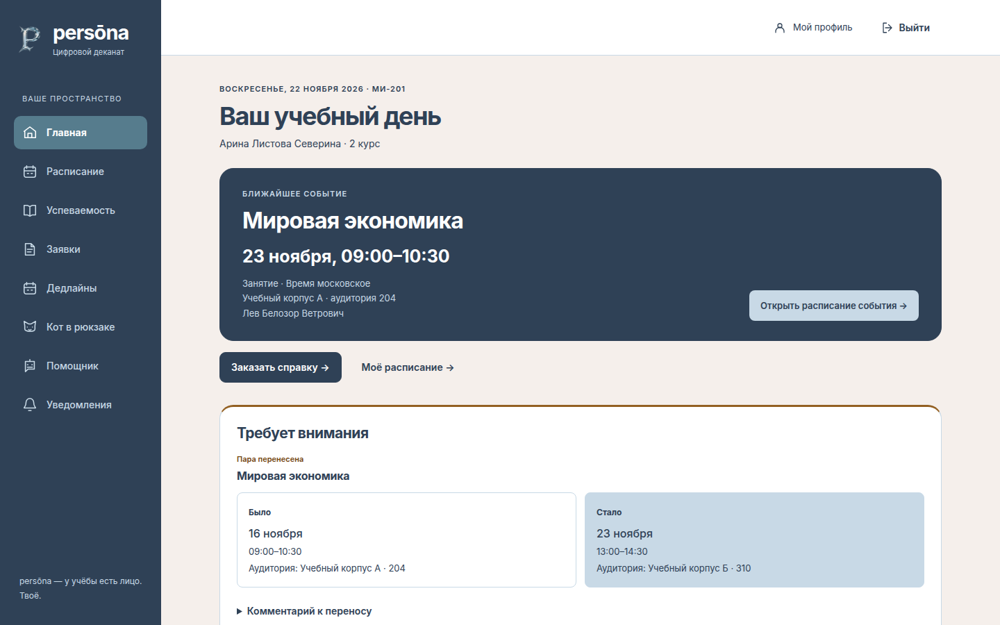
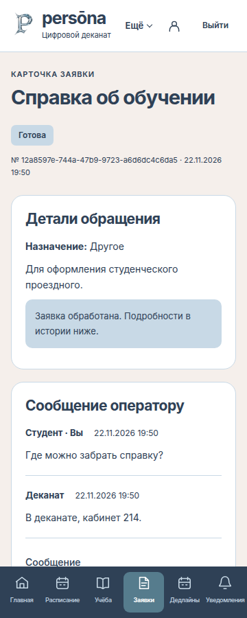

<p align="center">
  
</p>

<h1 align="center">persōna · Цифровой деканат будущего</h1>

Конкурсный кабинет студента на вымышленных данных. На главной видны ближайшие занятия, учебные результаты, сроки и состояние заявок. Оператор деканата обрабатывает справки и публикует объявления для закреплённых групп. Это конкурсный концепт, не официальный сервис вуза.

[Демонстрация](#сценарий-демонстрации) · [Локальный запуск](#локальный-запуск) · [Архитектура и защита](#архитектура-и-защита) · [Исходник конкурсного PDF](docs/contest/latex/README.md)

[](docs/readme/home-desktop.png)

*Главная студента при ширине экрана 1440 px.*

## Сценарий демонстрации

Первый студент входит, открывает расписание на сегодня и неделю, смотрит оценки и сессию и заказывает справку. Во втором окне оператор берёт заявку в работу и меняет статус. Студент видит уведомление, переписку и историю при повторном входе. Второй студенческий аккаунт видит свои данные. [Подробный сценарий и снимки](docs/evidence/REL09/review.md)

<p align="center">
  <a href="docs/readme/request-mobile.png"></a>
  <br>
  <em>Готовая справка и переписка с деканатом на экране шириной 360 px.</em>
</p>

## Локальный запуск

Нужны Python 3.13, uv и Docker с Compose v2. Django использует PostgreSQL 17 и зависимости из `uv.lock`. В WSL сначала включите интеграцию нужной дистрибуции в Docker Desktop и проверьте `docker info`.

```bash
uv sync --locked
cp .env.example .env
```

Замените заглушки в приватном `.env`. Задайте независимый секрет Django и пароль локальной БД. Для тестов используйте отдельную тестовую БД и учётную запись с правом создать её. Для нового демо уберите заглушки `DEMO_*_PASSWORD` из окружения, чтобы задать пароли через скрытый интерактивный ввод, или передайте отдельные вымышленные пароли через приватное окружение. Django не загружает `.env` самостоятельно.

```bash
set -a
source .env
set +a
docker compose --env-file .env -f deploy/compose.local.yaml up -d --wait
uv run python manage.py migrate
uv run python manage.py seed_demo
uv run python manage.py prepare_demo_window
uv run python manage.py collectstatic --clear --noinput
uv run gunicorn config.wsgi:application --bind 127.0.0.1:8000 --threads 4
```

Откройте [страницу входа](http://127.0.0.1:8000/login/). Для демо создаются `student.one`, `student.two` и `operator.demo`. `seed_demo` добавляет разные профили, расписание, оценки, заявки и объявления. Повторный запуск сохраняет пароли, действия студентов и историю. `prepare_demo_window` обновляет наполнение для показа по московской дате. Для запланированного показа можно передать `--anchor-date YYYY-MM-DD`. Для заполнения будущих учебных дней есть `extend_demo_schedule`.

Gunicorn/WhiteNoise используют манифест статики. После изменений CSS, JS или изображений повторите `collectstatic --clear --noinput` и перезапустите Gunicorn. `/health/live/` проверяет процесс, `/health/ready/` — соединение с БД. Локальная БД хранится в именованном томе Compose.

Локальный предпросмотр без БД запускается командой `bash scripts/preview.sh`. Страницы `/preview/` и `/preview/login/` содержат ранний макет без рабочего входа. Для сценария с сохранением используйте команды выше.

## Архитектура и защита

Django-приложение формирует HTML серверными шаблонами. PostgreSQL хранит пользователей, серверные сессии, учебные данные и историю заявок. CSS, JavaScript и графика поставляются локально. В production Caddy принимает HTTPS, Gunicorn исполняет приложение, WhiteNoise выдаёт статику. PostgreSQL и Gunicorn доступны через внутренние сети.

| Модуль | Ответственность |
| --- | --- |
| `accounts` | Вход и выход, профиль, роли, область оператора, персональные настройки |
| `academics`, `schedule`, `grades` | Учебная структура и записи студента, расписание и переносы, опубликованные оценки и сессия |
| `requests` | Заказ справки, история статусов, переписка и очередь оператора |
| `notifications`, `dashboard` | Лента, групповые объявления, сроки и сводка на главной |

Студенческие выборки проверяют владельца на сервере. Оператор может работать только с заявками и объявлениями закреплённых групп, без прав администратора. Каталог студентов в конкурсной конфигурации выключен. Локальный показ каталога на вымышленных данных доступен через `DEANERY_LOCAL_STUDENT_DIRECTORY=1` в `config.settings.local`.

Смена статуса заявки проверяет роль, область, текущее состояние и версию записи в транзакции. Владелец может отменить отправленную заявку. Оператор может взять её в работу, подготовить справку или отклонить заявку с пояснением. Повторная отправка использует ключ операции. Уведомления и история сохраняются в БД.

Пароли хеширует Django с Argon2. Сессия хранится на сервере, браузер получает cookie HttpOnly и SameSite. Изменения через формы защищены CSRF. Django Axes ограничивает вход по логину и IP. Production принимает служебные заголовки только на доверенной границе Caddy и использует Secure cookies.

- [Матрица доступа](docs/testing/access-matrix.md)
- [Вход, сессии и CSRF](docs/testing/security-review.md)
- [Целостность заявок и уведомлений](docs/testing/integrity-review.md)
- [Граница доверия Caddy](docs/decisions/002-production-proxy-boundary.md)
- [Происхождение графики и лицензии](docs/licenses.md)

### Необязательный ИИ-помощник

Помощник использует серверный адаптер Chat Completions. Для подключения задайте `AI_API_URL` (полный HTTPS URL), `AI_MODEL` и `AI_API_KEY` в серверной конфигурации и полностью перезапустите веб-процесс. Без подключения интерфейс показывает статус и сохраняет черновик. Провайдер получает вопрос и недавний контекст этого диалога. Профиль, оценки, расписание и документы автоматически не передаются. [Адаптер](apps/accounts/assistant.py) · [Проверки](tests/test_assistant.py)

## Проверки

```bash
uv sync --locked
uv run ruff check .
uv run ruff format --check .
uv run python manage.py check --settings=config.settings.test
uv run python manage.py makemigrations --check --dry-run --settings=config.settings.test
uv run pytest tests/test_foundation.py tests/test_cat_pixels.py
```

Для полного прогона запустите отдельную PostgreSQL 17, установите Chromium и задайте `TEST_DB_*`. pytest создаёт и удаляет указанную тестовую БД с префиксом `test_`. Используйте одноразовую БД, данные которой можно удалить.

```bash
uv run playwright install --with-deps chromium
uv run pytest
```

Документация проверок охватывает [браузеры и ширины экрана](docs/testing/ui-review.md), [перезапуск и восстановление БД](docs/testing/data-lifecycle.md) и [производительность](docs/testing/performance.md). [Конфигурация CI](.github/workflows/ci.yml)

## Развёртывание

Production требует отдельного окружения по [образцу конфигурации](deploy/production.env.example). В нём задаются секрет Django, разрешённые имена хостов и HTTPS origins, доверенная сеть прокси и закрытые доступы PostgreSQL. Миграции выполняются отдельно с подходящей ролью БД. Статика собирается при сборке образа.

Для обслуживания целевой среды предусмотрены команды `send_deadline_reminders`, `clearsessions` и `purge_auth_attempts` через `manage.py`. Периодический запуск и резервное копирование настраиваются на площадке.

- [Сборка, запуск Caddy и production smoke](docs/operations/production.md)
- [Обновление и восстановление из копии](docs/operations/update-recovery.md)
- [Аудит зависимостей и состав образов](docs/operations/image-audit.md)

## Требования конкурса

Конкурс оценивает идею, использование ИИ, реализацию и качество интерфейса по четырём шкалам до 10 баллов.

| ID | Обязательный сценарий |
| --- | --- |
| CORE-01 | Вход и профиль с ФИО, факультетом, направлением, курсом и группой |
| CORE-02 | Расписание на сегодня и неделю с аудиторией, преподавателем, переносами и изменениями |
| CORE-03 | Оценки и зачёты по дисциплинам, сессия и понятный итог учёбы |
| CORE-04 | Справка или заявление онлайн, сохранение заявки и её статуса |
| CORE-05 | Новости и объявления деканата, напоминания о сроках и изменениях |

- Рабочий прототип по ссылке. Основной путь от входа до заявки и статуса удобен на компьютере и мобильном экране от 360 px. Стек должен позволять масштабировать проект.
- Код пишут ИИ-ассистенты. Участники формулируют задачи и проверяют результат.
- Только вымышленные студенты, преподаватели и доступы. Данные каждого студента изолированы, включая запросы по прямым URL. Реальные системы вуза не подключаются.
- Кабинет обозначен как конкурсный концепт. Официальный логотип не используется. Материалы и зависимости требуют разрешающих лицензий.
- Пароли хранятся в виде хешей, служебные секреты задаются вне исходников и браузера.
- Сайт доступен из России без VPN до объявления итогов 28 ноября. Для жюри нужны два разных студенческих аккаунта и аккаунт оператора.

Капитан сдаёт работу в блоке «Моя работа». В задании указано начало приёма 8 ноября в 19:00 МСК. Дату окончания и условия конкретной карточки сверяет капитан. В комплект входят ссылка на сайт, три логина и пароля в комментарии, исходный код с доступом жюри на GitHub, GitVerse или в архиве на Яндекс Диске либо Google Диске и PDF или документ со скриншотами. Видео до пяти минут опционально.

Отчёт описывает проблему и выбор разделов, использованные ИИ-инструменты, IDE и сервисы, ключевые промпты и диалоги по этапам, удачные и неудачные итерации со скриншотами, вход, хранение и защиту данных, ручную работу команды. Результаты опроса добавляются, если его проводили. [Комплект и условия сдачи](docs/contest/readiness.md)

## Статус и приёмка

- [REL09](docs/evidence/REL09/review.md) подтверждает локальный сквозной путь под двумя студентами и оператором на 360 и 1440 px, сохранение заявки и отказ по чужим URL. Результат относится к сборке, описанной в отчёте.
- [CLEAN01](docs/evidence/CLEAN01/review.md) подтверждает 107 тестов без БД, три проверки Chromium и контрольную сборку PDF. Полный прогон с PostgreSQL на этапе очистки не выполнялся.
- Перед публичным релизом остаются согласование V2, проверка на физическом телефоне, выбор площадки, проверка развёрнутой версии и аккаунтов, восстановление целевой базы, доступ из России без VPN и подтверждение прав на исходный рисунок знака. Факт отправки подтверждает капитан.

## Работа над проектом

Сценарии делим на проверяемые этапы с ID требований. Код реализует исполнитель, основной агент проверяет diff и результаты независимо. Фиксируем в `docs/evidence/` постановки, фактические проверки, исправления и материалы отчёта без секретов. Перед визуальными изменениями и ревью интерфейса читаем `taste-skill:design-taste-frontend`. Модели, порядок делегации и шаблоны этапов описаны отдельно. [Рабочий процесс](docs/agents/WORKFLOW.md)

V1 — показ первой рабочей визуальной версии на телефоне и компьютере. V2 — приёмка полного пути студента и оператора перед первым публичным релизом. Пользователь подтверждает эти точки. Доступы, расходы без согласованного бюджета и фактическую отправку работы согласуем отдельно.

Принятые этапы коммитим и отправляем в рабочую ветку после проверки diff, состава файлов, настроек авторства и отсутствия секретов. Отправку подтверждаем сравнением локального SHA с `git ls-remote`. Протоколы этапов для публикации в `docs/evidence/` используют обезличенные реквизиты.
