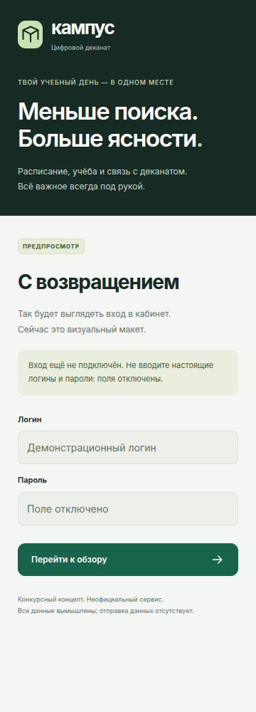
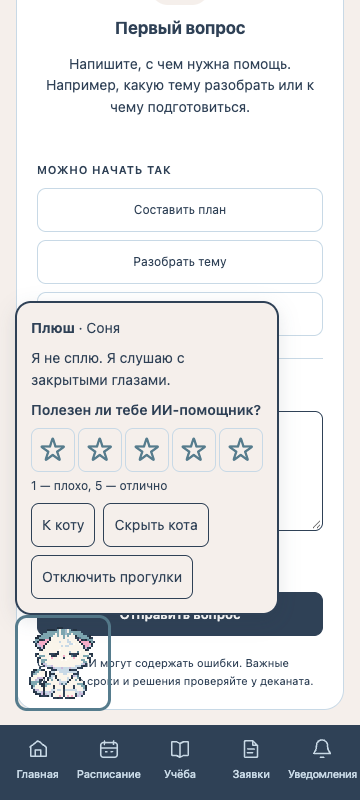
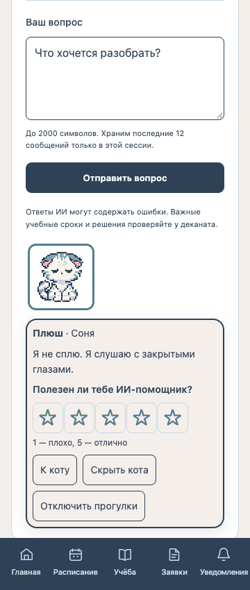
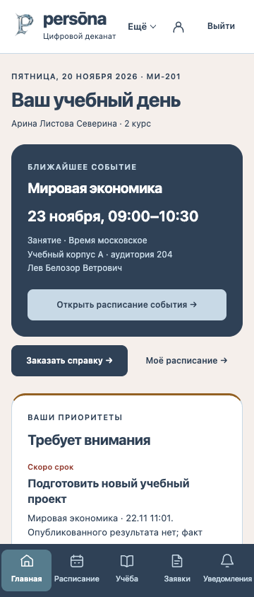
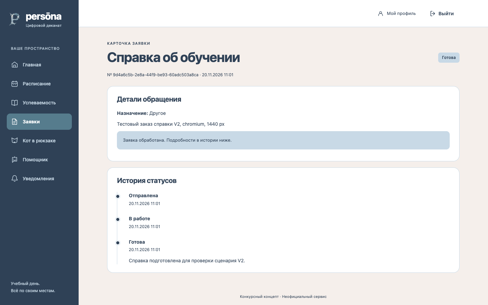

# persōna · Цифровой деканат будущего

Рабочая версия конкурсного отчёта. Скриншоты и результаты относятся к локальной проверке прототипа. Все сведения о студентах, преподавателях и заявках на экранах вымышлены.

Отчёт от 21 ноября 2026 года собран с актуальными кадрами локального кабинета, эскизами котов, изображением и историей знака и разбором исправлений. В блоке о потребностях приведены полные ответы на три вопроса анкеты, переданные командой. Раздел о работе с ИИ включает четыре коротких примера промптов по материалам проекта. [Исходник LaTeX и сборка](latex/README.md) · [Ревью отчёта](../evidence/REPORT03/review.md) · [Проверка примеров](../evidence/REPORT08/review.md)

## 1. Какую проблему решает кабинет

Расписание, оценки, объявления и ответы деканата обычно приходится искать в разных местах. persōna собирает эти сведения в одном кабинете. На главной студент видит ближайшее занятие, переносы, сроки и состояние своих обращений. За подробностями он переходит в соответствующий раздел.

| Раздел | Что делает студент |
| --- | --- |
| Профиль | Проверяет фамилию, имя и отчество, факультет, направление, курс и группу |
| Расписание | Смотрит день и неделю, открывает изменённое занятие и сверяет время, аудиторию и преподавателя |
| Учёба и сессия | Смотрит опубликованные баллы и зачёты, связывает их с расписанием аттестаций |
| Заявки | Заказывает справку и следит за статусом и ответом оператора |
| Уведомления | Читает объявления деканата и узнаёт о сроках и изменениях |

Отдельный кабинет оператора позволяет обработать справку и показать студенту историю статусов. Связку можно пройти в локальном браузере с двумя разными студенческими аккаунтами и оператором. Исходную постановку проблемы взяли из конкурсного задания. [Продуктовый бриф](../product/brief.md) · [Карта экранов](../ux/screens.md) · [Сквозная проверка](../evidence/REL09/review.md)

## 2. Какие инструменты использовали

| Инструмент или сервис | Роль |
| --- | --- |
| OpenAI Codex и Codex CLI | Постановка задач, архитектура, код, тесты и текстовые материалы. В начальном журнале зафиксированы GPT-6 Astra с высоким усилием и GPT-6.1 Sol со средним. В последующих заданиях GPT-6.1 Sol с высоким усилием использовался для постановки и ревью, а исполнителям задавали GPT-6.1 Sol с низким усилием. [Начальные настройки](../evidence/P00/prompt.md) · [Рабочий процесс](../agents/WORKFLOW.md) |
| Taste Skill | Проверка и доработка визуальной иерархии, контраста, размеров целей и поведения на разных ширинах. [Аудит интерфейса](../evidence/U05/review.md) |
| OpenAI ImageGen | Генерация портрета и атласа поз помощника, изображений котов и обработка референса знака. Для подготовки PNG и сеток использовали отдельные операции с Pillow, проектные генераторы на Python и Canvas. [Портрет](../evidence/AI01/imagegen.md) · [Атлас](../evidence/AI08/imagegen.md) · [Коты](../evidence/CAT08/imagegen.md) · [Знак](../evidence/U07/imagegen.md) |
| OpenRouter и OrcaRouter | Настройка дополнительного учебного чата. Для OpenRouter в задаче выбрали ERNIE Flash. В журнале последующей проверки этого сервиса есть реальные примеры ответов. Для DeepSeek V4 Flash через OrcaRouter документированы настройка адаптера и тест тела запроса. [OrcaRouter](../evidence/AI02/review.md) · [Выбор модели](../evidence/AI03/prompt.md) · [Проверка OpenRouter](../evidence/AI07/review.md) |
| Python, Django, PostgreSQL, uv и Docker | Приложение, хранение данных, воспроизводимое окружение и отдельные тестовые базы |
| Git, GitHub, Ruff, pytest и Playwright | Версии и ревью, проверка кода, серверных сценариев и браузеров. [Инфраструктурный этап](../evidence/A01-A02/implementation.md) · [Последняя репетиция](../evidence/REL09/review.md) |
| OpenAI Docs, веб-поиск, Bash и средства терминала | Сверка первичной документации, чтение исходников и локальные проверки скриптов. [Инструменты этапа P00](../evidence/P00/prompt.md) |

## 3. Какие задания давали ИИ

1. **Постановка и контроль.** Команда попросила выделить обязательные требования, выбрать стек и разделить работу на ограниченные задания для исполнителя и независимое ревью. Одно из уточнений пользователя — «завершенные этапы мы будем коммитить и пушить для поддержания версионирования». Результат — инструкции проекта, архитектура, ограничение путей для правок и проверка каждого принятого этапа. [Дословные фрагменты](../evidence/P00/prompt.md)
2. **Сквозное демо.** В постановку вошли два учебных аккаунта, оператор с ограниченной областью, разные данные и условие «Повтор и конкурентный запуск не сбрасывают пользовательские состояния». Результат проверялся через повторный вход, реальные заявки и действия оператора. [Промпт B12/F08](../evidence/B12-F08/prompt.md) · [Репетиция](../evidence/REL09/review.md)
3. **Чужие профили.** Архитектор поручил выключить каталог в конкурсной конфигурации до выполнения выборки, сохранив свой профиль. В серверной проверке прямая ссылка на чужую карточку вернула 404. [Промпт REL01](../evidence/REL01/prompt.md) · [Ревью](../evidence/REL01/review.md)
4. **Карточка кота на телефоне.** Исполнитель получил условие разместить карточку после формы помощника при ширине до 850 px. В первую итерацию вернули замечание: после расширения окна звёзды могли уходить за внутреннюю прокрутку. Финальная проверка подтвердила доступность звезды и кнопки скрытия, сохранение фокуса и запись оценки в базу. [Задание](../evidence/REL08/prompt.md) · [Замечание](../evidence/REL08/review.md) · [Повторная проверка](../evidence/REL08/review-02.md)
5. **Академические правила чата.** Команда попросила отклонять просьбы выполнить контрольную за студента и оставлять объяснение методов на другом примере. После отказа первоначальный ответ повторил варианты экзаменационного вопроса. После уточнения промпта прошли три сценария отказа и один сценарий объяснения темы. [Постановка](../evidence/AI07/prompt.md) · [Что ответила модель](../evidence/AI07/review.md)

## 4. Как менялся интерфейс

**Первый макет входа на 360 px, 4 ноября.** В предпросмотре под рабочим названием «Кампус» команда проверяла читаемость и навигацию. Поля были отключены, поскольку вход ещё не был подключён. [Макет главной](../evidence/U02-F01/dashboard-mobile-360.png) · [Ревью этапа](../evidence/U02-F01/review.md)

**Неудачный вариант на 360 px, 20 ноября.** Карточка кота перехватывала нажатия на поле и отправку сообщения.

**Исправление, 20 ноября.** На узком экране кот появляется под формой. Отдельная браузерная проверка подтвердила, что можно взаимодействовать с полем и отправкой при раскрытой карточке. [Сравнение на этапах REL08](../evidence/REL08/review-02.md)

**Рабочая главная на 360 px, 20 ноября.** Видно ближайшее занятие и можно сразу перейти к заказу справки. [Расписание и перенос](../evidence/REL09/rescheduled-360.png) · [Учебные результаты](../evidence/REL09/grades-360.png)

**Результат сквозного сценария, 20 ноября.** Карточка показывает статус «Готова», три события обработки и комментарий, введённый оператором при проверке. [Карточка со стороны оператора](../evidence/REL09/operator-1440.png)

## 5. Как работают вход, данные и защита

Студент входит по логину и паролю демонстрационного аккаунта. Django сравнивает пароль с хешем Argon2 и сохраняет сессию на сервере. Браузер хранит идентификатор сессии в cookie с флагом HttpOnly. Учебные сведения, заявки и их история хранятся в PostgreSQL.

При открытии страниц сервер берёт пользователя из сессии и проверяет владельца данных. Оператор видит заявки закреплённых групп. В проверке второй студент получил 404 по прямым ссылкам на чужой профиль и заявку. Изменения через формы защищены CSRF. Повтор отправки после потери ответа проверили на реальной заявке, где сервер сохранил одну запись. Ключ провайдера чата задаётся на сервере. [Архитектура](../../README.md#архитектура-и-защита) · [Результаты проверки](../evidence/REL09/review.md) · [Безопасность входа](../testing/security-review.md)

## 6. Что делали вручную

- Участник передал конкурсное задание и уточнил, что у кода, постановки и проверки должны быть отдельные роли, а принятые этапы должны попадать в Git. [Запросы пользователя](../evidence/P00/prompt.md)
- Команда согласовала первый визуальный показ, затем выбрала название persōna и передала референсы знака и палитры. После просмотра варианта фона пользователь уточнил расположение маленьких знаков. [Согласование V1](../evidence/B12-F08/prompt.md) · [Название и палитра](../evidence/U06/prompt.md) · [Визуальное уточнение](../evidence/U13/review.md)
- Участник запустил локальную установку и прислал журнал ошибок. В журнале успешную установку Python-зависимостей сменил тайм-аут Docker Hub при загрузке PostgreSQL, после чего команда миграции получила отказ соединения. Исходный журнал приведён в диалоге команды. Его содержимое с путями пользователя не включено в отчёт.

Ручные проверки участников на физическом телефоне и сведения о работе вне журнала команда уточняет перед выпуском документа.
